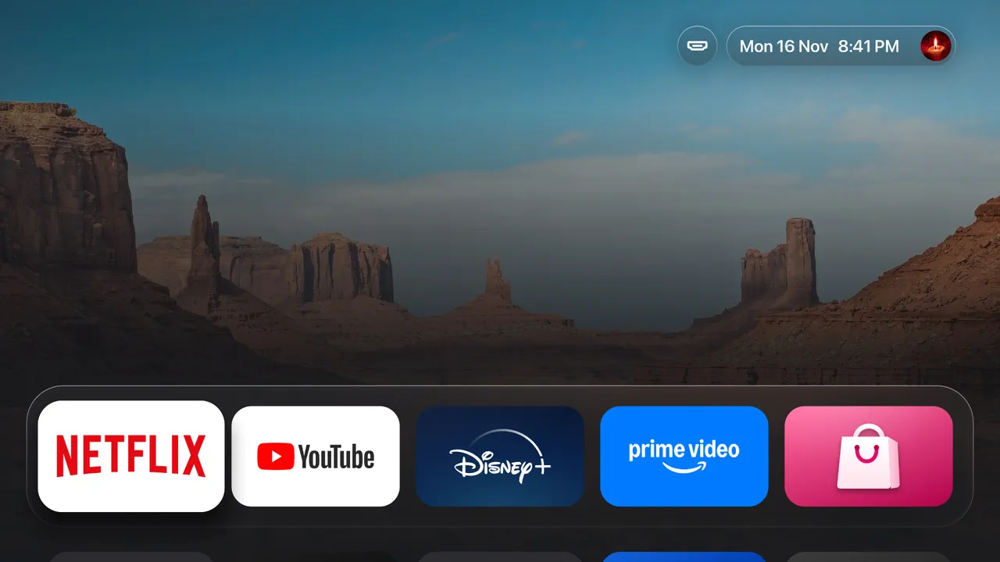
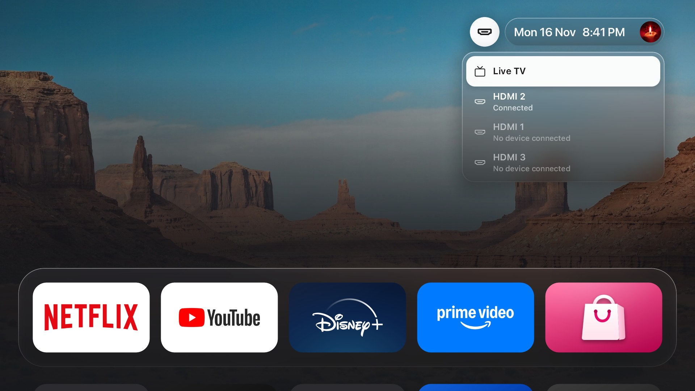
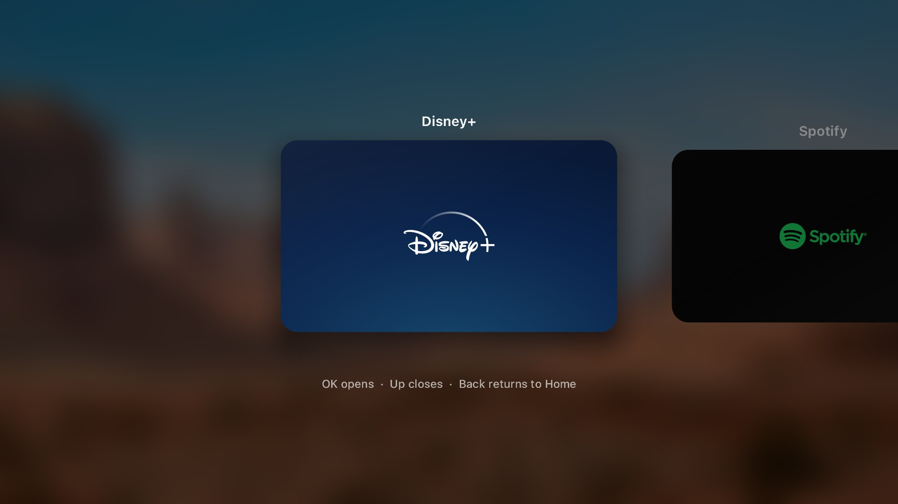
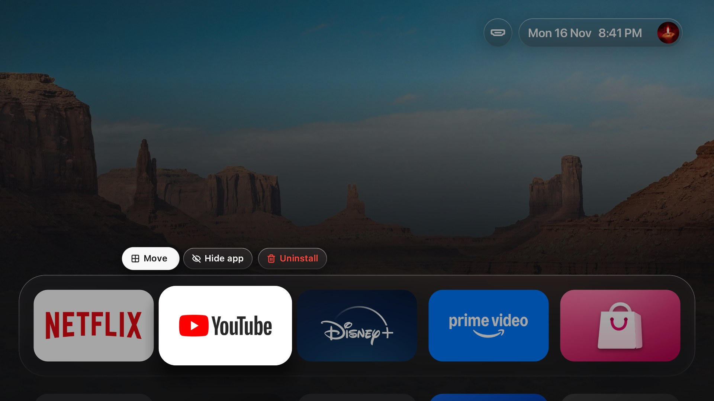
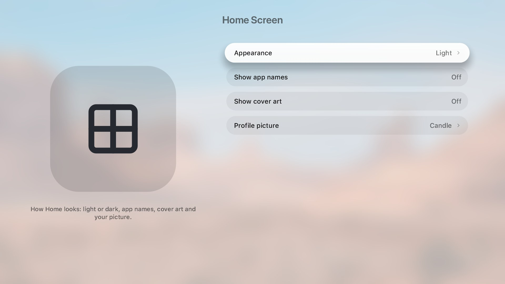
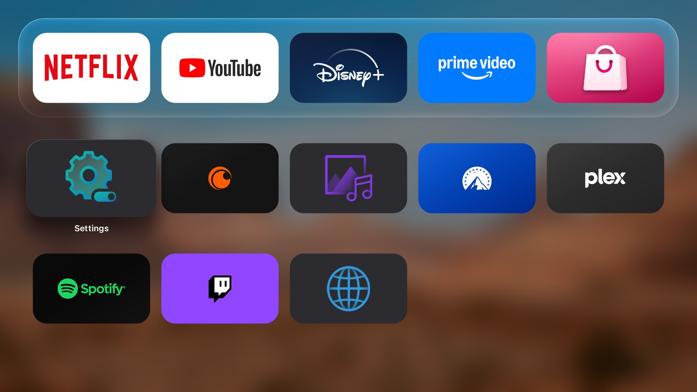
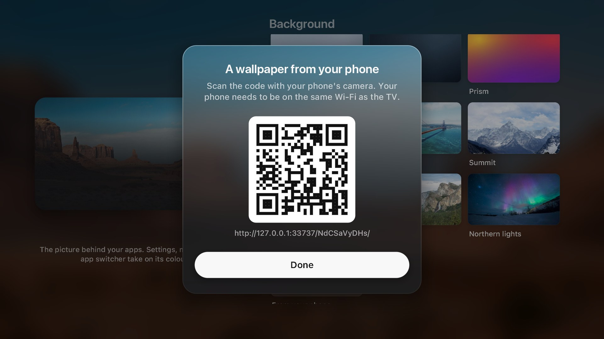

<div align="center">


# Lounge

**A native home screen for rooted LG webOS TVs, written in Rust.**

[](https://github.com/YashwanthKamireddi/lounge/actions/workflows/ci.yml)
[](https://github.com/YashwanthKamireddi/lounge/releases/latest)
[](#compatibility)
[](license)



[Install](#install) · [Screens](#screens) · [How it works](#how-it-works) · [Build](#build)

</div>

## Overview

Lounge replaces LG's Home with a single native binary that draws with OpenGL ES 2.0. It shows a
dock of five apps over a wallpaper, every other app in a grid below, and an Inputs button for the
TV's sources. It runs as the TV's real Home: the Home button opens it, and it resumes instead of
restarting.

Measured on the test TV (LG 65UQ801C0SB, webOS 22, Mali-G52):

| Metric                             | Value                                      |
| ---------------------------------- | ------------------------------------------ |
| First frame from a cold start      | 0.46 s                                     |
| Back to Home from an app           | about 0.1 s                                |
| Frame pacing, scrolling the grid   | 16.7 ms mean, 0 slow frames in 600 (1080p) |
| CPU while idle on Home             | 0 ticks over 60 s (6 wake-ups)             |
| Own memory on Home / behind an app | about 25 MB / about 11 MB                  |

Other TVs will measure differently; `tools/tv-bench.sh` measures your own.

## Screens

<table>
  <tr>
    <td width="50%"></td>
    <td width="50%"></td>
  </tr>
  <tr>
    <td width="50%"></td>
    <td width="50%"></td>
  </tr>
  <tr>
    <td width="50%"></td>
    <td width="50%"></td>
  </tr>
</table>

- **A dock of five apps,** and every other app one press down.
- **Inputs one press up:** Live TV and every HDMI port, plugged-in ones first, under LG's names.
- **Hold OK on an app** to move, hide or uninstall it.
- **An app switcher** for what's open: OK opens, Up closes, Back returns.
- **Your own wallpaper and profile picture,** sent from your phone with a QR code.
- **Light, Dark or Automatic,** plus a focus outline, larger names and reduced motion.

## Install

You need an LG TV rooted with an elevated [Homebrew Channel](https://www.webosbrew.org/).

1. In Homebrew Channel › Settings › Extra repositories, add
   `https://github.com/YashwanthKamireddi/lounge/releases/latest/download/repo.json`
2. Install **Lounge** from Homebrew Channel. Updates arrive there too.
3. Open Lounge and choose **Make Home**. From then on, the Home button opens Lounge.

Prefer a file? Install `io.github.yashwanthkamireddi.lounge_1.3.0_arm.ipk` from
[Releases](https://github.com/YashwanthKamireddi/lounge/releases/latest) with
[webOS Dev Manager](https://github.com/webosbrew/dev-manager-desktop).

**Going back to LG's Home only needs the remote:** turn off Settings › General › Lounge as Home.
Uninstalling Lounge in Homebrew Channel and restarting the TV does it too. Nothing is written to
LG's firmware, and if Lounge fails to start three times in a minute, it gives Home back to LG by
itself. (Over SSH: `sh /var/lib/lounge/home.sh disable`.)

## How it works

Lounge is one native Rust binary that draws straight to the TV's graphics plane with OpenGL ES
2.0 through SDL2, not a web page.

- **Liquid glass.** One shader samples a pre-blurred backdrop, with refraction at the rim, so a
  glass panel costs a single pass. Opaque tiles are written to the stencil buffer first, so
  nothing hidden behind them is shaded.
- **Sleeping when nothing happens.** The loop waits until there's input or news from webOS
  (app, input and window changes on its Luna bus). On Home it wakes about once a minute, for
  the clock. Behind an app it frees its textures and gives the memory back.
- **Starting fast.** Compiled shaders are cached on the TV, pictures ship ASTC-compressed for the
  GPU, and decoding runs on worker threads. The drawing thread never reads a file or waits on the
  network.
- **Becoming Home.** Lounge's binary is bind-mounted over LG Home's (webOS 5, 6 and 22
  to 24), or a Home manifest pointing at Lounge is mounted (webOS 25 and 26). Pressing Home brings
  back the running Lounge instead of starting a new one. A crash loop gives Home back to LG, and
  turning it off only ever needs the remote.
- **Cold boot.** A Homebrew Channel boot hook mounts Lounge once LG's Home has started, drops
  LG Home's saved RAM image so it can't come back, and opens Home over the input webOS starts
  (following the TV's Home Auto Launch setting).
- **Photos from a phone.** Only while its QR code is on screen, a small HTTP server listens on
  the TV's LAN address behind a random token; the phone frames the photo and sends a JPEG, and
  the TV decodes it again and bakes the shading and glass backdrops itself.
- **Kept honest by CI.** Every screen is rendered headless, and a change that paints more than
  3.25 screens per frame, or holds more than 64 MB of artwork or 8 MB of text, fails the build.

[development.md](development.md) goes deeper into each part.

## Compatibility

Lounge runs on LG TVs from 2020 on: webOS 5 and 6, then webOS 22 to 26 (LG names these by year;
inside they are versions 7 to 11). It picks the right way to become Home on each by itself.

It is used daily on webOS 22 (version 7.6); the other versions are covered by tests. If a TV can't have Lounge as its Home, Settings says
why, and Lounge still opens as an app.

## Known limits

- After a cold start, LG's Home shows for a few seconds before Lounge takes over: webOS starts it
  before any homebrew can run.
- English only for now.

Bugs and reports from other TVs: [issues](https://github.com/YashwanthKamireddi/lounge/issues).

## Privacy

No telemetry and no accounts. Settings stay on the TV, and the only network requests are for the
weather (Open-Meteo, OpenStreetMap). The phone photo server listens only while its QR code is on
screen. Lounge writes no log files unless you switch diagnostics on
by creating `/var/lib/lounge/debug`. Rooting is your call, and Lounge comes without warranty (see
the [license](license)).

## Build

```sh
nix develop
pnpm install --frozen-lockfile
pnpm sdk
export WEBOS_NDK="$PWD/.build/toolchain/arm-webos-linux-gnueabi_sdk-buildroot"
pnpm run package   # dist/io.github.yashwanthkamireddi.lounge_1.3.0_arm.ipk
pnpm dev           # desktop preview with sample apps
```

[development.md](development.md) covers the architecture, tests, diagnostics and releases.

## License

MIT. See [license](license). Not affiliated with LG, Apple or any app brand shown.
